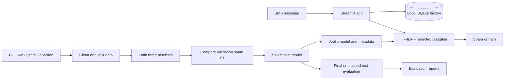

<p align="center">
  <a href="https://github.com/DenverCoder1/readme-typing-svg">
    
  </a>
</p>

<p align="center">
  
  
  
  
  
</p>

# SpamShield — Intelligent SMS Spam Detection

SpamShield is a beginner-friendly NLP application that classifies an SMS message as **spam** or **ham** (legitimate). It trains and compares three classical machine-learning models, evaluates the selected model on data kept separate during model selection, and provides a Streamlit interface with local prediction history.

> This is an educational project, not a production security filter. Predictions can be wrong; do not rely on them alone for financial or safety decisions.

## Project overview

SMS spam can contain misleading offers, unwanted advertising, or suspicious requests. SpamShield turns each message into numerical text features with TF-IDF and compares three classifiers. The best validation model is chosen using spam-class F1-score, then evaluated once on an untouched test set.

### Dataset and attribution

The project uses the **SMS Spam Collection** from the [UCI Machine Learning Repository](https://archive.ics.uci.edu/dataset/228/sms). Its official downloadable archive is [sms+spam+collection.zip](https://archive.ics.uci.edu/static/public/228/sms+spam+collection.zip). On training, SpamShield downloads and extracts the corpus into `data/raw/` if it is not already available locally. The supplied workspace copy is used as an offline fallback.

Dataset credit: Almeida, T. A., Hidalgo, J. M. G., & Yamakami, A. (2011), *Contributions to the study of SMS spam filtering: new collection and results.* Please retain the dataset's [UCI attribution and terms](https://archive.ics.uci.edu/dataset/228/sms) when redistributing it. The corpus is not committed to this repository.

### Algorithms

| Model | Beginner-friendly description |
|---|---|
| Multinomial Naive Bayes | A fast probabilistic baseline that works well with word-count-like features. |
| Logistic Regression | A linear classifier that estimates which class best fits the message features. |
| Linear Support Vector Machine | Finds a separating boundary between spam and ham in the TF-IDF feature space. |

### How TF-IDF works

TF-IDF (term frequency–inverse document frequency) gives a message's words higher weight when they are useful for distinguishing messages, and lower weight to words common across many messages. Each model is a scikit-learn `Pipeline`, so the text vectorizer is fitted only on its training data.

## Architecture



## Project structure

```text
SpamShield/
├── app.py
├── train.py
├── requirements.txt
├── README.md
├── .gitignore
├── src/
│   ├── __init__.py
│   ├── data_loader.py
│   └── database.py
├── data/
│   └── raw/
├── models/
├── reports/
├── assets/
└── tests/
    └── test_database.py
```

Training creates `models/spam_classifier.joblib` and `models/model_metadata.json`. Evaluation reports are written under `reports/`; the downloaded corpus, local SQLite database, and model binary are excluded from Git.

## Setup and run

Use Python 3.10 or newer and an internet connection if no local copy of the dataset is available.

### Windows PowerShell

```powershell
py -m venv .venv
.\.venv\Scripts\Activate.ps1
python -m pip install --upgrade pip
pip install -r requirements.txt
python train.py
python -m pytest
streamlit run app.py
```

If PowerShell blocks environment activation, use `.\.venv\Scripts\python.exe -m pip install -r requirements.txt` and prefix Python commands with `.\.venv\Scripts\python.exe`.

### macOS or Linux

```bash
python3 -m venv .venv
source .venv/bin/activate
python -m pip install --upgrade pip
pip install -r requirements.txt
python train.py
python -m pytest
streamlit run app.py
```

The first training run reads the local dataset copy if present; otherwise it downloads the official UCI ZIP. Run `streamlit run app.py` after training. If the trained model is missing, the app explains how to create it.

## Evaluation

Model selection uses spam F1 on a stratified validation split. The final model is refit on the training and validation portions together, and evaluated on the reserved test portion. This keeps the test set out of the model-selection process.

Metrics are generated from the current dataset and saved by `train.py`. The measurements below are from the completed training run in this workspace, not targets or fabricated examples.

| Report | Contents |
|---|---|
| `reports/model_comparison.csv` | Accuracy, spam precision, spam recall, and spam F1 for each model on validation data. |
| `reports/test_metrics.json` | The selected model's metrics on the untouched test set. |
| `reports/confusion_matrix.csv` | Test-set true and predicted ham/spam counts. |
| `reports/classification_report.txt` | Per-class precision, recall, and F1 on the test set. |

The completed run on the supplied corpus retained **5,160 messages** after cleaning and duplicate removal (4,518 ham and 642 spam). The stratified split used 3,096 training, 1,032 validation, and 1,032 test messages.

| Model | Validation accuracy | Spam precision | Spam recall | Spam F1 |
|---|---:|---:|---:|---:|
| Linear SVM | 0.9874 | 0.9675 | 0.9297 | **0.9482** |
| Logistic Regression | 0.9845 | 0.9308 | 0.9453 | 0.9380 |
| Multinomial Naive Bayes | 0.9622 | 1.0000 | 0.6953 | 0.8203 |

Linear SVM was selected using validation spam F1. On the untouched test set it achieved **0.9864 accuracy**, **0.9524 spam precision**, **0.9375 spam recall**, and **0.9449 spam F1**. Its test confusion matrix (actual rows, predicted columns; ham then spam) was `[[898, 6], [8, 120]]`. These are measured results for this dataset and fixed random seed; rerun training to regenerate them.

## App and database

The Streamlit app accepts one message, shows a clear **SPAM** or **HAM** result, identifies the selected model, and lets you clear the input. It deliberately does not show confidence percentages because not every selected model provides calibrated probabilities.

SQLite stores each prediction's ID, original message, predicted category, model name, and timestamp in the local `spamshield.db` file. The database is created automatically when the app starts. Messages stay local and are not sent to an external service. Database tests use temporary databases and do not touch the runtime database.

## Screenshots

Add genuine screenshots captured from your own running app to `assets/`, then link them here. Do not use mock results or generated screenshots.

```markdown


```

## GitHub presentation

Repository: [ItsFaizan-official/spamshield-sms-spam-detection](https://github.com/ItsFaizan-official/spamshield-sms-spam-detection)

For a polished repository page, keep this README at the repository root, run training so that the real reports are present, and add genuine screenshots captured from the app. Suggested repository topics: `nlp`, `sms-spam-detection`, `scikit-learn`, `streamlit`, and `machine-learning`.

To publish to a new GitHub repository, create an empty repository on GitHub and then run the following from the project directory (replace the URL):

```powershell
git init
git add .
git commit -m "Build SpamShield SMS spam detection project"
git branch -M main
git remote add origin https://github.com/ItsFaizan-official/spamshield-sms-spam-detection.git
git push -u origin main
```

## Future improvements

- Add cross-validation to measure performance variability.
- Tune vectorizer and classifier parameters using training-only folds.
- Add multilingual SMS support and monitor performance across message sources.
- Consider probability calibration and an opt-in, privacy-conscious review workflow.
